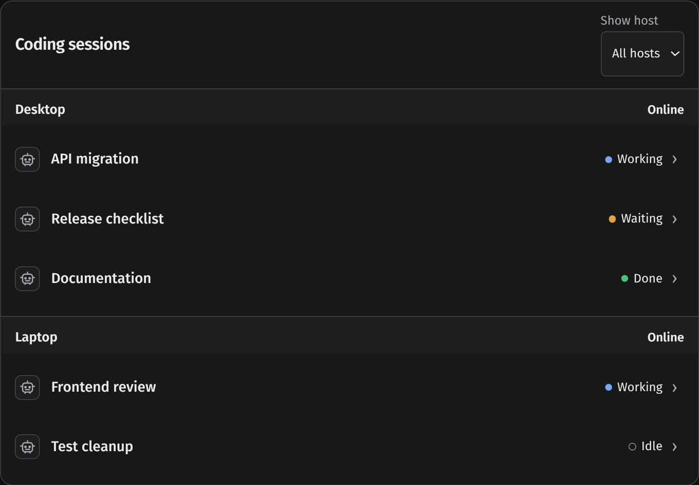
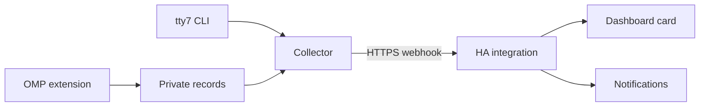

# HA-tty7

**Monitor your terminal coding sessions from Home Assistant.**

HA-tty7 connects [tty7](https://github.com/l0ng-ai/tty7) to Home Assistant so you can see which sessions are working, waiting for you, or finished—across one or more computers. It includes a HACS integration, a dashboard card, and optional notifications through Home Assistant or the Android Companion app.

It is **read-only monitoring**, not a remote terminal: you cannot send prompts, approve tools, run commands, or stop sessions from the card.

[Installation](#installation) · [How it works](#how-it-works) · [Agent support](#agent-support) · [Notifications](#notifications) · [Releases](https://github.com/angelwzr/HA-tty7/releases)

## What it looks like



*Actual HA-tty7 card rendered with synthetic data in the local preview. This example uses the dark tty7 appearance with tab-name collection enabled; it contains no private session data.*

## What you get

- **One view across hosts.** Compact session rows, host availability, and optional workspace/tab grouping.
- **Useful details on demand.** Tap or click a row to wrap its full session name and reveal reported model, thinking level, source quality and other available metadata. Collapsed rows stay compact.
- **Notifications that identify the work.** The approved session/tab name is the title; the message says “Finished.”, “Needs your input.” or “Failed.” Only sources with reliable event proof can notify.
- **Home Assistant integration.** Roster, connectivity and diagnostic entities; a bundled Lovelace card with a visual editor; native-theme or tty7-style appearance and English/Russian labels.
- **Explicit source health.** Stale, disconnected, missing and unknown data stay distinguishable from a healthy idle session or an empty roster.

## How it works



The collector runs under your Linux user, normally as a **systemd user service**. It polls structured `tty7 --json agents` data and, when enabled, bounded workspace/tab/pane inventory. It sends allowlisted snapshots on changes and periodic heartbeats—not terminal output or a stream of conversations.

For Oh My Pi, the installer also adds a managed extension. It observes the main session through supported public APIs and writes private, short-lived metadata files. The collector uses those records instead of trusting tty7's potentially child-contaminated OMP status.

Home Assistant validates each host-bound snapshot, reconciles the session roster, and tracks freshness using its own receipt time. More than 45 seconds without accepted contact marks the host stale; a failed read does not become “all done” or an empty roster. Notification decisions use per-run/input proof and silent startup/recovery baselines.

The browser reads Home Assistant entities only. There is **no MQTT broker, separate dashboard backend, or inbound collector listener** to maintain. The collector needs outbound HTTPS access to your HA instance.

## Agent support

Display support and notification support are different. Detection alone does not prove that a main run has genuinely finished.

| Agent | Status and metadata source | Notifications in 0.4.6 |
| --- | --- | --- |
| Oh My Pi | Managed native extension; main-session status, selected model/thinking level, owner-scoped background work and opt-in full session name | Confirmed finishes, blocking questions/approvals and terminal failures |
| Claude Code | Stock tty7 integration; only metadata tty7 actually reports | Silent: stock-only status lacks the required event proof |
| Codex | Stock tty7 integration; only metadata tty7 actually reports | Silent: stock-only status lacks the required event proof |
| OpenCode | Stock tty7 integration; only metadata tty7 actually reports | Silent: stock-only status lacks the required event proof |
| Pi | Stock tty7 integration; only metadata tty7 actually reports | Silent: stock-only status lacks the required event proof |

Other agents reported by tty7 can appear in the roster too. Configure their supported integrations in tty7 itself; HA-tty7 does not replace their hooks or install patched tty7 binaries. Missing model/effort values remain unavailable rather than being guessed from configuration or session files.

### Oh My Pi activation

Native reporting is the default for every detected OhMyPi pane; no per-pane setup is required. New OMP processes discover the managed extension automatically.

**Existing OMP sessions need `/restart` after their foreground and background work finishes.** Installing an extension does not replace modules already loaded in those processes, and `/reload-plugins` is not an extension hot reload. The installer never sends terminal input or interrupts running work.

Missing, stale or conflicting native records become **Unknown**, not a fallback to stock status. A card-wide missing-source warning can refer to another session whose Unknown row is hidden by the current filter.

[Native source behavior and limitations](docs/install.md#oh-my-pi-native-status)

## Installation

### Requirements

- Home Assistant **2026.10.0+** and HACS **2.0.5+**.
- A monitored Linux host with stock tty7 running, **Python 3.11+**, and util-linux **`flock`**.
- Verified HTTPS access from the host to HA. A private CA is supported; certificate verification is never disabled.
- A systemd user service for the normal installation, or manual operation with `--no-service`.
- For phone alerts, an already configured Home Assistant Companion notification action.

The native lifecycle implementation is checked against **OMP 18.12.5**; unavailable public APIs fail closed. HACS installs the HA side only—each monitored Linux user/host also needs a collector and its own pairing URL.

### 1. Install the Home Assistant integration

1. Add `https://github.com/angelwzr/HA-tty7` under **HACS → Custom repositories**, with type **Integration**.
2. Download HA-tty7 and restart Home Assistant.
3. Open **Settings → Devices & services → Add integration → HA-tty7**.
4. Configure the host ID, display label, HTTPS HA URL and optional notification destination. Finish pairing and keep the generated URL private.

### 2. Install the host collector

Download the pinned installer:

```sh
curl --fail --show-error --location --proto '=https' --tlsv1.2 \
  https://raw.githubusercontent.com/angelwzr/HA-tty7/v0.4.6/install.py \
  --output install-ha-tty7.py
```

Review the script, then run it:

```sh
python3 install-ha-tty7.py
```

It prompts for the host ID and a **hidden pairing URL**, installs the collector and managed OMP extension, and verifies a real delivery before enabling the user service. Existing pairing, privacy settings and custom service units are preserved. No sudo, HA account token or automatic lingering is required.

For a private CA, use `--ca-file /path/to/ca.pem`. Nonstandard tty7 paths and manual installation are documented in the [installation guide](docs/install.md#linux-collector).

### 3. Add the dashboard card

Edit a Home Assistant dashboard, choose **Add card → HA-tty7**, and select your hosts in the visual editor. The integration serves and registers the card; no manual JavaScript resource copying is needed.

Start with compact rows. Tap a session to read its full name across multiple lines; tap again to collapse it. Keyboard users can focus a row and press Enter or Space. Enable model/effort, grouping, additional details or Unknown rows only when useful. [All card options](card/README.md#configuration)

### 4. Enable session/tab names

Names are private and **off by default**. To show them in the card and notification titles, edit `~/.config/ha-tty7/collector.toml`:

```toml
collect_inventory = true
include_names = true
```

Apply the change by restarting only the collector:

```sh
systemctl --user restart ha-tty7.service
```

Explicit tab names take precedence. Automatic labels and native OMP session names need separate consent with `include_derived_labels = true`; those labels can contain directory names or generated session descriptions. With all three naming settings enabled, OMP's full name comes from its public API rather than tty7's 40-character CLI label. The collector grants local name sampling through a private marker; disabling consent stops name sampling/export. Persisting inventory or native names across HA restarts is another opt-in: **HA-tty7 → Configure → Retain inventory**.

**Still seeing an ellipsis after expanding?** Stock tty7 26.10.0 truncates automatic JSON labels to 40 characters. The 0.4.6 native reporter avoids that limit for OMP names up to 256 Unicode characters. Existing OMP sessions need `/restart` after their work finishes to load this new source; other agents retain whatever title their stock source provides.

## Notifications

For a tab named **API migration**, the default notifications are:

| Confirmed event | Title | Message |
| --- | --- | --- |
| Main run ends normally with no pending work | API migration | Finished. |
| A blocking question or required approval needs your response | API migration | Needs your input. |
| Main run ends in a terminal failure | API migration | Failed. |

No host, agent type, pane number or session ID is included in default text. If no fresh approved name is available, the title is **Unnamed session**. Tapping a Companion notification opens the configured dashboard; persistent HA notifications include its link.

Only authoritative events notify. Child/advisor activity, idle/working changes, cancellation, retries, compaction, missing sources, and startup/reconnect baselines stay silent. Repeated terminal events and the same input request are deduplicated. OMP's public failed-or-cancelled retry ambiguity also stays silent rather than guessing.

**“Finished” means the run ended normally—not that the requested task or its tests succeeded.** A card row's reported Done status alone is not enough to send a finish notification.

Title and message templates are editable under **HA-tty7 → Configure**. The defaults are `{session_name}` and `{event_message}`. Upgrades migrate each exact old built-in independently; custom templates, routing and disabled notification toggles survive. [Template fields and bounds](docs/install.md#notification-templates)

If you also forward OMP/tty7 desktop notifications to your phone, that independent route can still produce duplicates. HA-tty7 does not change OS notification settings.

## Privacy and boundaries

- **Metadata only.** No terminal/scrollback, prompt or conversation content, tool arguments/results, launch arguments, process/port data, Git data or raw logs are exported. Separately opted-in derived labels are the exception described above.
- **Private credentials.** Each host uses its own bearer-secret webhook URL. Keep it out of chat, screenshots, Git and access logs. Do not put a broad HA account token on collector hosts.
- **Verified transport.** Outbound HTTPS uses certificate and hostname verification. HA's host-bound webhook remains local-only; check proxy/VPN routing rather than disabling protections.
- **No remote control.** Permission-mode metadata is informational. The card cannot approve actions, execute commands, restart agents or send input.
- **Honest missing data.** Inferred/weak status stays distinguishable from confirmed reports. Session duration, token/cost metrics and conversation previews are not provided; HA contact time is not session age.

[Detailed collection and retention settings](docs/install.md#optional-names-and-inventory)

## Updating

1. Update HA-tty7 through HACS and restart **Home Assistant first**.
2. Run the matching host installer to update the collector and managed extension.
3. In each already-running OMP session, use `/restart` only after its work finishes.

Older records remain readable, but reporters without outcome/input proof cannot notify. Updating HA before the collector avoids rejecting fields that an older integration does not understand.

[Changelog](CHANGELOG.md) · [Latest release](https://github.com/angelwzr/HA-tty7/releases/latest) · [Removal instructions](docs/install.md#updates-and-removal)

## Development

| Directory | Responsibility |
| --- | --- |
| `collector/` | Standard-library Python collector and managed OMP extension |
| `custom_components/ha_tty7/` | Native HA integration, shared protocol and bundled frontend |
| `card/` | TypeScript/Lit card, visual editor and synthetic browser fixtures |
| `integration-tests/` | Tests using real Home Assistant components |
| `tools/` | Allowlisted source export, release archive and changelog-note generation |

The frontend uses Node.js 22.12+:

```sh
cd card
npm ci
npm run dev
```

The preview uses synthetic data and does not connect to tty7 or HA. Build/test instructions: [card](card/README.md#development-and-verification), [native HA](integration-tests/README.md), [release preparation](docs/install.md#release-preparation).

[Report a bug](https://github.com/angelwzr/HA-tty7/issues) with versions and sanitized reproduction steps—not pairing URLs or raw session dumps. Local tests and preview screenshots do not prove physical Android notification delivery.

## License

[MIT](LICENSE). Bundled Lit retains its BSD-3-Clause notices.
